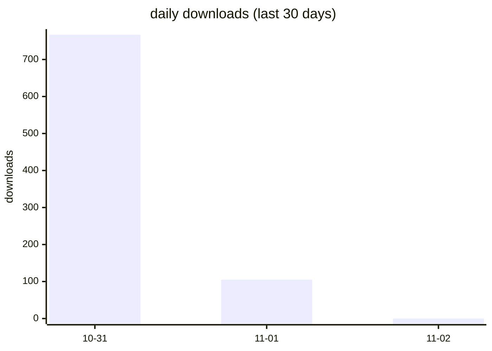
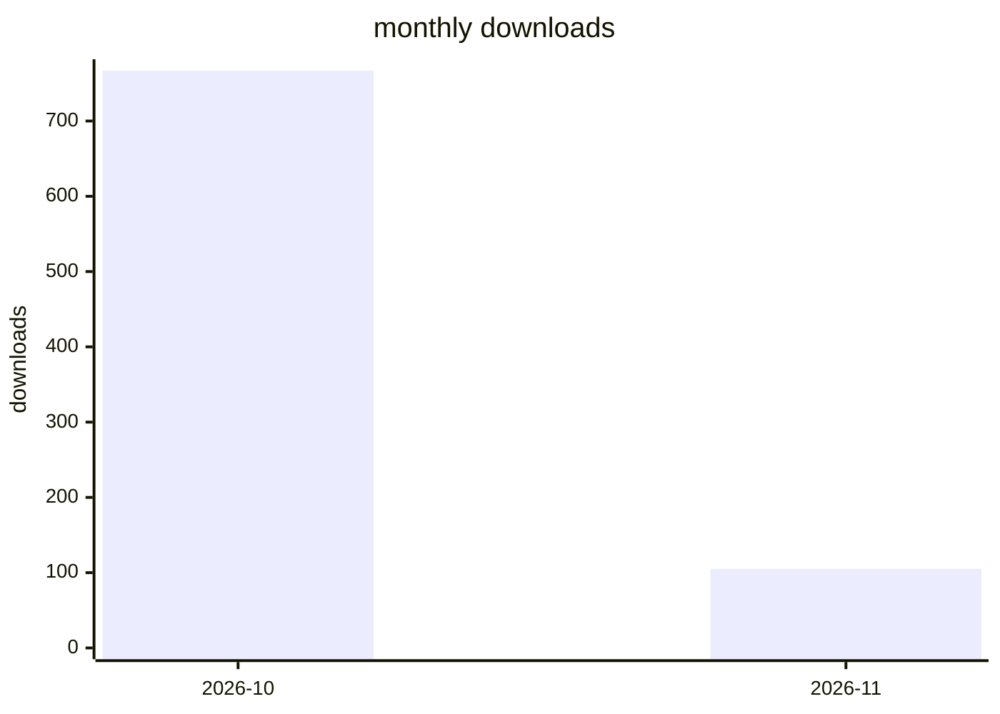

<!-- 本文件由 scripts/update-download-stats.mjs 自动生成，请勿手改 -->
# opencode-loop-recover npm 下载量统计 — 2026

> 数据源：api.npmjs.org。npm 下载统计有约 1–3 天结算延迟，
> 最近 5 天标记为"待结算"，数值会在 npm 结算后自动修正。

## 概览

| 指标 | 下载量 |
| --- | ---: |
| 最近已结算日（—） | — |
| 近 7 天（已结算） | 0 |
| 近 30 天（含待结算） | 872 |
| 本年度累计 | 872 |
| 最高单日 | — |

## 近 30 天每日下载量

## 每月下载量

## 每日明细

| 日期 | 下载量 | 备注 |
| --- | ---: | --- |
| 2026-11-02 | 0 | 待结算 * |
| 2026-11-01 | 105 | 待结算 * |
| 2026-10-31 | 767 | 待结算 * |

\* 待结算：npm 尚未结算该日数据，当前值可能为 0 或偏低，结算完成后自动更新。
